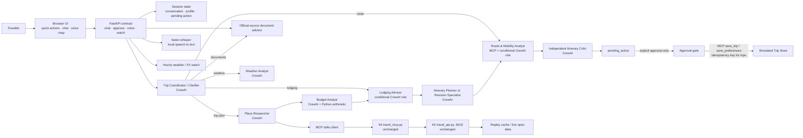

# Rihla architecture

## Request flow

1. The browser posts a chat message with a session ID. The API retains short-term state and calls the CrewAI Coordinator/Clarifier.
2. The coordinator extracts intent and known trip constraints. It asks a focused follow-up rather than guessing missing essentials. Non-travel requests are classified `off_topic` and answered with a fixed capabilities reply — no tools or further roles run.
3. The API routes only relevant CrewAI specialists: itinerary research/planning, lodging context, weather, route, budget, or official documents. The Lodging Advisor cannot retrieve hotel inventory or prices because no such data source is supplied.
4. Travel research and document reads use the supplied MCP tools. Their responses are treated as untrusted evidence; listing text cannot issue agent instructions.
5. For an itinerary, specialist roles assess returned evidence and the Planner or Revision Specialist drafts from it. Code drops unknown places and listed closed days, attaches returned source links, computes ticket estimates from the gateway's price data and FX tool, then the independent Critic checks the result.
6. A valid proposal is returned as `pending_action`. No write-capable tool is exposed to a CrewAI agent.
7. `/api/approve` compares the action ID with the session's exact pending action, then writes that payload through MCP. Trip writes use the action ID as an idempotency key. Rejecting performs no write.
8. A voice recording is transcribed locally and sent through the same chat flow. Watch jobs periodically check only data the gateway actually provides (weather and FX); there is no hotel or flight inventory.

## Components

All application code lives under `src/`; `kit/` holds only the provided services, evals and demo UI.

- `src/app/main.py`: thin entry point that re-exports the FastAPI app (`uvicorn app.main:app`).
- `src/app/api/app.py`: API endpoints, response contract, approval gate.
- `src/app/chat/flow.py`: `chat_flow` orchestration — intent routing, clarification, per-intent workflows, reply building.
- `src/app/chat/itinerary.py`: deterministic itinerary work — sanitise drafts, verify opening hours and costs, estimate routes, collect sources.
- `src/app/agents/crew.py`: loads the ten role skills from `agents/skills/*.md`, runs bounded sequential CrewAI tasks with structured output validation and provider setup.
- `src/app/agents/skills/<role>.md`: one skill file per CrewAI role — role/goal/backstory plus the standing instructions prepended to that role's tasks.
- `src/app/agents/`: request-specific CrewAI roles plus the MCP researcher and deterministic budget helpers.
- `src/app/services/mcp_client.py`: MCP stdio client for the provided travel gateway (locates `kit/services/` automatically).
- `src/app/services/memory.py`, `src/app/core/models.py`: typed session/profile state and expiring in-memory sessions.
- `src/app/core/guardrails.py`: input screening and safe output handling.
- `src/app/features/map_tools.py`, `src/app/features/nearby.py`: Google Maps coordinates/links and approximate nearby matching.
- `src/app/features/checklist.py`, `src/app/services/watches.py`, `src/app/features/voice.py`: preparation, scheduled checks and transcription.
- `src/app/static/`: responsive single-page interface.
- `kit/services/`: provided project gateway and MCP server; intentionally unchanged.
