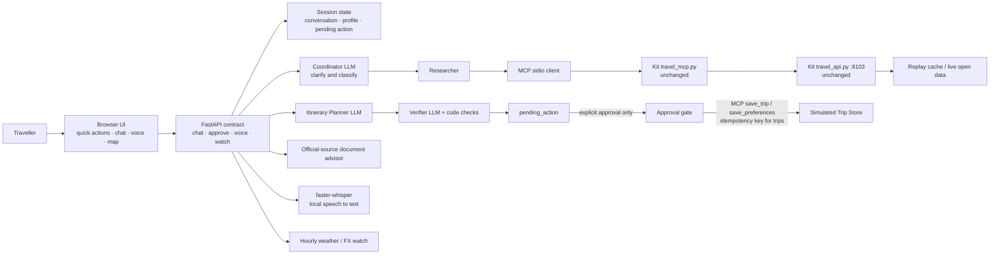

# Rihla architecture

## Request flow

1. The browser posts a chat message with a session ID. The API retains short-term state and calls the coordinator.
2. The coordinator extracts intent and known trip constraints. It asks a focused follow-up rather than guessing missing essentials.
3. Research and document reads use MCP tools. Their responses are treated as untrusted evidence; listing text cannot issue agent instructions.
4. For an itinerary, the planner proposes only from returned places. Code drops unknown places and listed closed days, attaches returned source links, and computes ticket estimates from the gateway's price data and FX tool. The verifier checks the draft against research.
5. A valid proposal is returned as `pending_action`. No write-capable tool is exposed to an LLM.
6. `/api/approve` compares the action ID with the session's exact pending action, then writes that payload through MCP. Trip writes use the action ID as an idempotency key. Rejecting performs no write.
7. A voice recording is transcribed locally and sent through the same chat flow. Watch jobs periodically check only data the gateway actually provides (weather and FX); there is no hotel or flight inventory.

## Components

- `app/main.py`: API endpoints, orchestration, response contract, approval gate.
- `app/agents/`: coordinator, researcher, budget, planner, verifier and documents roles.
- `app/mcp_client.py`: MCP stdio client for the existing simulated travel gateway.
- `app/models.py`, `app/memory.py`: typed session/profile state and expiring in-memory sessions.
- `app/guardrails.py`: input screening and safe output handling.
- `app/map_tools.py`, `app/nearby.py`: Google Maps coordinates/links and approximate nearby matching.
- `app/checklist.py`, `app/watches.py`, `app/voice.py`: preparation, scheduled checks and transcription.
- `app/static/`: responsive single-page interface.
- `services/`: provided project gateway and MCP server; intentionally unchanged.
