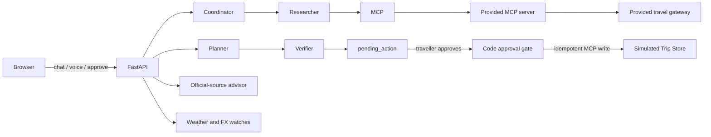

# Rihla — Travel, thoughtfully planned

Rihla is a travel-planning crew that asks what it needs, researches sourced activities, and leaves itinerary decisions and saving in the traveller's hands. It is built on the provided Scenario 3 travel gateway and MCP server.

> **Nothing is booked or purchased.** A saved itinerary is only stored in the simulated Rihla Trip Store. Prices and routes are estimates.

## What makes it useful

- Conversational clarification for dates, budget, party size and children's ages, pace, interests and hotel use.
- Six distinct roles: Coordinator, Researcher, Budget Analyst, Itinerary Planner, Verifier and Documents Advisor.
- Sourced day plans with itinerary revisions, opening-day checks, converted listed ticket estimates and disclosed uncertainty.
- Quick-start suggestion chips for trip preparation, official travel-document links, one-day planning, nearby places, trip plans and hourly watches — everything is done in chat.
- Google Maps coordinate pins and supported Google Maps links for approximate nearby search.
- Voice input with local faster-whisper speech-to-text.
- Traveller preference memory and explicit approval for saved changes.
- A hard approval gate for trip saves, using the approved action ID as the idempotency key.
- Chat-first responsive web UI: trip details (dates, budget, party size) are collected conversationally, and itineraries render as inline cards with source citations, a map and approve/reject controls.

## Run the app

### Docker Compose

1. Copy `.env.example` to `.env`.
2. Put your OpenRouter key in `.env` as `OPENROUTER_API_KEY=...`. Do not commit this file.
3. Start the travel gateway and app:

```powershell
docker compose up --build
```

Open `http://localhost:8000`. Replay mode serves cached Istanbul and Amman data by default. The gateway API is on `http://localhost:8103`.

### Local Python

Use Python 3.12. From this directory:

```powershell
py -3.12 -m venv .venv
.venv\Scripts\activate
pip install -r requirements.txt
```

Copy `.env.example` to `.env`, set the OpenRouter key, then open two terminals:

```powershell
uvicorn services.travel_api:app --port 8103
```

```powershell
uvicorn app.main:app --port 8000
```

Visit `http://localhost:8000`. `GET /health` reports whether the model key is configured.
The simulated gateway defaults to `dev-key-change-me`. If you replace `TRAVEL_API_KEY` in `.env`, also export that same value in the shell used to start the gateway; the provided gateway reads its key from the process environment.

## API and evaluation

The app implements `POST /api/chat`, `POST /api/approve`, `POST /api/voice` and `GET /health`. Optional hourly watch endpoints are `POST /api/watch`, `GET /api/watch/{session_id}` and `DELETE /api/watch/{watch_id}`.

Run the supplied gateway/MCP smoke test and the ten brief cases after starting the gateway and app:

```powershell
python check_kit.py
python evals/run_evals.py
python evals/run_evals.py --cases evals/cases.extra.jsonl -v
```

The eval runner can write a scorecard with `--out evals/scorecard.md`. No score is claimed here because running the cases requires an OpenRouter key and live app processes. Please report the result actually produced in your presentation.

### Current scorecard status

| Measure | Status |
|---|---|
| Kit API/MCP smoke test | Passed in this workspace |
| Local unit tests | 10 passed |
| Kit sample cases | Not run: OpenRouter key was not available in the execution environment |
| Additional cases | Not run: OpenRouter key was not available in the execution environment |
| Before/after fix | Before: an LLM draft could include unsupported place names or a listing-closed weekday. After: code keeps only MCP-returned places, replaces source URLs from those tool results, queries opening hours for selected stops, and filters closed-day/timing conflicts before the approval proposal. |

## Architecture



See [`ARCHITECTURE.md`](ARCHITECTURE.md) for the full request flow, and [`SUMMARY.md`](SUMMARY.md) for the presentation checklist and implementation notes.

## Repository map

| Path | Responsibility |
|---|---|
| `app/main.py` | FastAPI endpoints, agent orchestration and approval enforcement |
| `app/agents/` | LLM and tool roles for intake, research, budget, itinerary, verification and documents |
| `app/mcp_client.py` | MCP client for the provided travel tools |
| `app/models.py`, `app/memory.py` | Session state, traveller profile and short-term conversation memory |
| `app/guardrails.py` | Input screening and response safety checks |
| `app/nearby.py`, `app/map_tools.py` | Maps coordinate parsing, links, distance filtering |
| `app/voice.py`, `app/watches.py`, `app/checklist.py` | Voice, periodic checks and pre-trip preparation |
| `app/static/` | Single-page UI (HTML, CSS and JavaScript) |
| `app/data/travel_docs.json` | Official government references used for document questions |
| `services/` | Provided simulated gateway and MCP server; unchanged |
| `evals/` | Provided ten cases and eight additional scenarios |

## What is real and what is simulated?

| Component | Details |
|---|---|
| LLM | Real OpenRouter API; key must be supplied by the operator |
| Places and routes | Real open data through the kit's gateway; replay cache by default |
| Weather and currency | Open-Meteo and ECB-based data through the gateway |
| Trip Store and traveller profiles | Simulated local system |
| Test overlays | Synthetic data for evaluation only |
| Voice | Local faster-whisper model; downloads/loads on first use |
| Flights, hotel rates, reservations and payments | Not provided and never performed |

## Honest limitations

- Replay mode only has the kit's Istanbul and Amman cache. Other destinations require network access and `TRAVEL_MODE=live` or `record`.
- Wikivoyage listing prices and hours can be stale; official venue details should be rechecked. Estimates don't promise a trip will fit its budget.
- Adult ticket prices are not child prices. Unknown prices are omitted from totals.
- Nearby distance is a straight-line walking-time estimate, not routed navigation. This data kit has no pharmacy listings.
- Visa and entry rules depend on passport nationality, trip purpose, transit and travel dates. The advisor is informational, not legal advice; confirm uncertain cases with the relevant embassy or consulate.
- Watches can check the gateway's weather/FX data. No hotel or flight pricing feed exists.
- Session state and watches live in process memory and clear on restart. Production deployment should use durable storage and a managed scheduler.
- Voice requires microphone permission and a compatible faster-whisper install; normal text chat still works without voice.

## Attribution

Travel data is provided by the kit: Wikivoyage (CC BY-SA 4.0), OpenStreetMap contributors (ODbL), Open-Meteo (CC BY 4.0), and European Central Bank reference rates via Frankfurter. Keep source citations and licence attribution when redistributing derived data.
